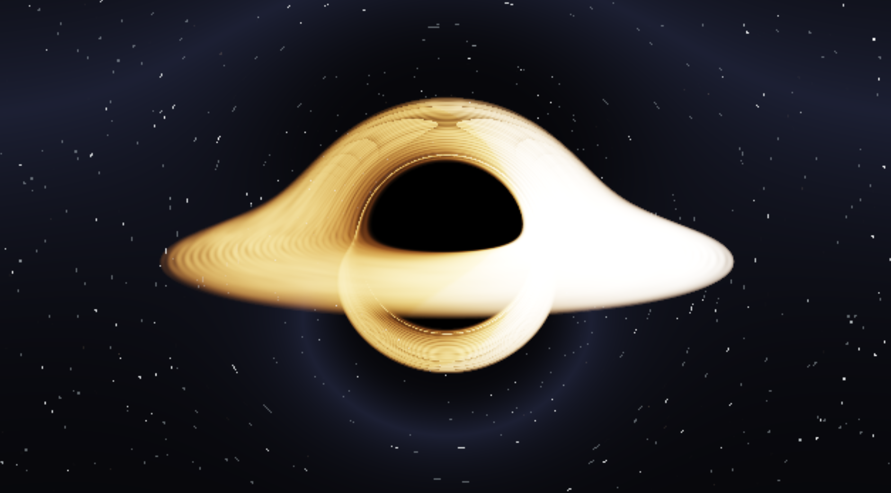

# blackholegl

Blackholegl is a simulation of The Gargantua Blackhole seen in the movie intersteller



A huge inspiration for this project was Kavan's video about simulating a blackhole in C++, check out his video on [youtube](https://www.youtube.com/watch?v=8-B6ryuBkCM).

I'm still working on it, so yeah<br>

## quick start

**Download a prebuilt binary** from the [releases page](https://github.com/dummy3ye/blackholegl/releases):

| platform | file | how to run |
|----------|------|------------|
| Windows x64 | `blackholegl-windows-x64.zip` | unzip it, then double click `blackholegl.exe` |
| Linux x86_64 | `blackholegl-linux-x86_64.tar.gz` | `tar -xzf blackholegl-linux-x86_64.tar.gz && ./blackholegl` |

Both archives contain the binary and the `shaders/` folder it needs, no build
tools and no install step.

> [!IMPORTANT]
> A GPU driver with **OpenGL 4.3 Core** is required (compute shaders).
> Check with `glxinfo \| grep "OpenGL version"` on Linux, or
> [glview](https://www.gfxbench.com/opengl) on Windows.

**Or build it yourself**, all you need is CMake (>= 3.21) and a C++ compiler:

```sh
git clone https://github.com/dummy3ye/blackholegl
cd blackholegl

# Linux
cmake --preset linux-release && cmake --build --preset linux-release
./build/linux-release/blackholegl

# Windows
cmake --preset windows-msvc-release && cmake --build --preset windows-msvc-release
.\build\windows-msvc-release\Release\blackholegl.exe
```

GLFW is downloaded and built automatically when it is not installed on the
system, so there is no dependency to install by hand.

## controls

| input | action |
|-------|--------|
| mouse drag | orbit the camera |
| scroll | zoom (3.5M - 60.0M) |
| `0` - `5` | cycle render resolution (240p - 1440p) |
| `q` | cycle quality (very low / low / medium / high) |
| `f` | toggle the FPS overlay |
| `esc` | quit |

## command line

```
blackholegl [OPTIONS]

  --res=<int>, -r <int>     Render height (default 720, range 120-4320)
  --quality=<name|int>      very-low (0), low (1), medium (2), high (3)
  --show-fps                 Show real-time FPS / GPU overlay
  --very-low, -vl            Preset: quality=0, res=360p
  --help, -h                 Show this message and exit
  --version                  Show version and exit
```

## building from source

### requirements

- CMake >= 3.21 (for the presets) and a C++17 compiler
- OpenGL 4.3 Core capable driver

Nothing else, GLFW is fetched and built by CMake when it is missing. On Linux
the system packages are used when they are available:

```sh
# Debian / Ubuntu
sudo apt install cmake clang libglfw3-dev libgl1-mesa-dev

# Arch
sudo pacman -S cmake clang glfw
```

### presets

| preset | what it does |
|--------|--------------|
| `linux-release` / `linux-debug` | Linux build, debug adds address + UB sanitizers |
| `windows-msvc-release` / `windows-msvc-debug` | Windows build with MSVC |

```sh
cmake --preset linux-release
cmake --build --preset linux-release
```

### make

`make` is a thin wrapper around the CMake presets, it works on Linux and on
Windows (on Windows it goes through `scripts/build-windows.ps1`, so CMake does
not have to be on `PATH`):

| target | what it does |
|--------|--------------|
| `make` | build the release binary |
| `make run` | build and run |
| `make run RES=360` | run with a custom render resolution |
| `make run SHOW_FPS=1` | run with the FPS overlay |
| `make debug` | debug build, on Linux with address + UB sanitizers |
| `make install` | install binary + shaders under `$(PREFIX)` (`/usr/local` on Linux, `dist` on Windows) |
| `make clean` | remove build artefacts |

### windows

`install.bat` checks for CMake and the Visual Studio build tools, and builds
the project:

```bat
install.bat          :: build
install.bat -Tools   :: install missing tools with winget first, then build
```

Both tools can also be installed by hand:

```bat
winget install Kitware.CMake
winget install Microsoft.VisualStudio.2022.BuildTools --override "--quiet --wait --norestart --add Microsoft.VisualStudio.Workload.VCTools --includeRecommended"
```

### wsl2

Follow the Linux instructions, then note that a common problem in WSL2 is
getting the OpenGL version right. If anything looks off, run:

```sh
source scripts/wsl2-mesa-version-fix.sh
```

## troubleshooting

| symptom | fix |
|---------|-----|
| `Window creation failed` | the driver is too old, needs OpenGL 4.3 Core. Update the GPU driver, on Intel/AMD Linux use Mesa |
| `Failed to open shader file` | the `shaders/` folder is missing next to the binary, re-extract the archive |
| black screen but the window opens | the GPU dropped the compute shader, try `--quality=very-low` or a smaller `--res` |
| slow on integrated graphics | use `--res=360 --quality=very-low` |
| `GLFW init failed` | no display available, WSL2 needs WSLg enabled |

## project layout

```
src/        application code
include/    headers
shaders/    GLSL shaders loaded at runtime
external/   vendored dependencies (glad)
scripts/    helper scripts
```

CMake is the single source of truth for the build, the `Makefile` and
`install.bat` are thin wrappers on top of it.

## license

MIT, see [LICENSE](LICENSE).
